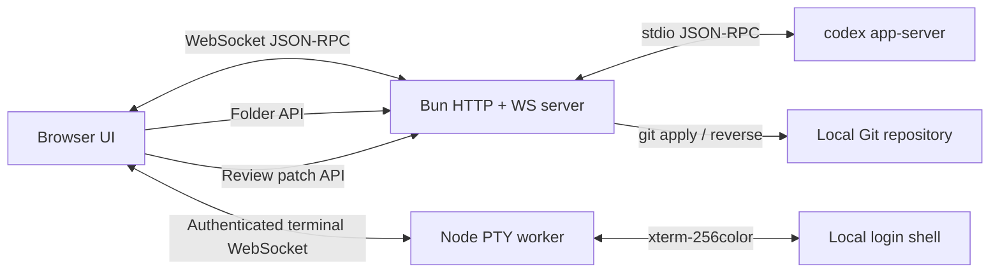

# Codex PiWeb UI

<p align="center">
  <strong>A Pi Web-style local, LAN-accessible WebUI for the real Codex app-server.</strong>
</p>

<p align="center">
  <a href="./README-zh.md">简体中文</a> ·
  <a href="./CONTRIBUTING.md">Contributing</a> ·
  <a href="./SECURITY.md">Security</a>
</p>

<p align="center">
  <a href="./LICENSE"></a>
  <a href="https://github.com/Shinyruooooo/codex-webui/stargazers"></a>
  <a href="https://github.com/Shinyruooooo/codex-webui/issues"></a>
  <a href="https://bun.sh/"></a>
</p>

> [!NOTE]
> **Secondary Development & Attribution:** **Codex PiWeb UI** is a secondary development (derivative work) built upon [`lezi-fun/codex-webui`](https://github.com/lezi-fun/codex-webui) (MIT License), with its three-column workspace layout and core interaction experience redesigned to align with [`agegr/pi-web`](https://github.com/agegr/pi-web) (MIT License). Original copyright and license notices are preserved in [`LICENSE`](./LICENSE) and [`THIRD_PARTY_NOTICES.md`](./THIRD_PARTY_NOTICES.md).

> [!IMPORTANT]
> This is an **unofficial community project**. It is not affiliated with, endorsed by, or maintained by OpenAI. OpenAI and Codex are trademarks of their respective owners.

Codex WebUI connects directly to `codex app-server --stdio` and exposes the local Codex experience through a responsive browser interface. It keeps real threads, models, streaming responses, tool activity, approval requests, diffs, and token usage instead of simulating them in a static frontend.


## Highlights

- **Pi Web-style 3-column workspace**:
  - **Left Sidebar**: Icon-only switcher between **Sessions** (stable project grouping + live running spinner / approval & unread completion dots) and **Files** (project file tree, hover `@` mention, upload), plus a one-click **Terminal** trigger; manual toggle with adaptive push layout that never covers conversations
  - **Center Conversation**: Real streaming turns, tool activity timeline, immediate optimistic submit feedback, and a compact runtime footer (icon-only status indicator, elapsed timer, compact `↑in ↓out · ctx%` token summary, and `5h` / `Weekly` remaining quota with expandable details)
  - **Right Side Panel**: Invoked directly from left-side actions or review triggers for **File preview** (Markdown/code/image), **PTY Terminal** (`xterm.js` 256-color + resize + Vim/control keys), and **Diff Review** (Unified/Split diff, word wrap, Git Undo/Reapply)
- **Skills management (v0.5.0):** Official / Personal catalogs, native enable switches and prompt invocation, personal Markdown editing, and offline curated-cache installation; see [Skills management](#skills-management-v050).
- Real `codex app-server --stdio` bridge over WebSocket with automatic SSE fallback
- Real model catalog, reasoning effort options, thread rename (`thread/name/set`), context compaction (`thread/compact/start`), Markdown/JSON export, and per-session draft persistence
- Pi Web-aligned `@` file mention autocomplete (immediate file/folder list on `@`, folder trailing-slash drilldown `@folder/`, quoted paths with spaces, paste/drag/upload attachments)
- Command, file-change, network, and permission approval surfaces (**Allow once**, **Allow similar commands**, session-level approval)
- Explicit **System / Light / Dark** theme selector in Settings (`General`, `Appearance`, `Configuration`, `Profile`, `Keyboard shortcuts`)
- Localhost-only by default; authenticated LAN access is opt-in with `scrypt` password storage, `HttpOnly` signed session cookies, and per-IP login rate limiting

## Requirements

- [Bun](https://bun.sh/) 1.3 or newer
- Node.js 20 or newer, used by the native PTY worker
- [OpenAI Codex CLI](https://www.npmjs.com/package/@openai/codex), installed and authenticated
- Git, for Review Undo/Reapply
- macOS or Linux recommended; Windows has not been fully tested

Install Codex CLI if needed:

```bash
npm install -g @openai/codex
codex
```

Complete the Codex sign-in flow before starting this project.

## Quick start

```bash
git clone https://github.com/Shinyruooooo/codex-webui.git
cd codex-webui
bun install
bun run start
```

Open:

```text
http://127.0.0.1:8899
```

The default bind address is localhost. Use the folder button in the composer or sidebar to select the project Codex should work in.

### LAN password login

To listen on your LAN, start the server without an authentication variable:

```bash
HOST=0.0.0.0 bun run start
```

The first LAN browser sees a password setup screen. After a password of at least 12 characters is confirmed, Codex WebUI stores only a salted `scrypt` credential in `~/.codex/codex-webui-auth.json`, signs in that browser, and requires the password after a restart. Because the first reachable LAN client can claim this setup, complete it only on a trusted network.

For unattended deployments, provide the password at startup instead:

```bash
HOST=0.0.0.0 CODEX_WEBUI_PASSWORD='use-a-long-random-password' bun run start
```

Direct `localhost` access remains available without the password screen. LAN requests must set or enter a password before the main application bundle, HTTP APIs, or WebSocket bridges are available. Successful authentication uses a signed `HttpOnly`, `SameSite=Strict` session cookie.

`CODEX_WEBUI_ACCESS_TOKEN` remains available for compatibility with Basic/Bearer clients. `CODEX_WEBUI_PASSWORD` takes precedence over both the managed password and access token for browser login. Set `CODEX_WEBUI_AUTH_STORE` to move the managed credential file.

## Configuration

Copy the example file if you want custom settings:

```bash
cp .env.example .env
```

Bun does not automatically load every `.env` convention in all execution contexts, so exporting variables explicitly is the most predictable option:

```bash
export HOST=0.0.0.0
export PORT=8899
export CODEX_WEBUI_ACCESS_TOKEN="$(openssl rand -hex 32)"
export CODEX_WEBUI_CWD="$HOME/projects/my-project"
export CODEX_WEBUI_REVIEW_ROOT="$HOME/projects/my-project"
bun run start
```

| Variable | Default | Description |
| --- | --- | --- |
| `HOST` | `127.0.0.1` | HTTP/WebSocket bind address |
| `PORT` | `8899` | HTTP/WebSocket port |
| `CODEX_WEBUI_PASSWORD` | unset | Optional browser login password for LAN access; bypasses first-run setup |
| `CODEX_WEBUI_AUTH_STORE` | `$CODEX_HOME/codex-webui-auth.json` | Salted managed password credential created by first-run setup |
| `CODEX_WEBUI_ACCESS_TOKEN` | unset | Compatibility secret for Basic/Bearer clients and browser login when no password is configured; username `codex` |
| `CODEX_WEBUI_CWD` | repository directory | Initial Codex working directory |
| `CODEX_WEBUI_REVIEW_ROOT` | `CODEX_WEBUI_CWD` | Exact Git root allowed for Undo/Reapply |
| `CODEX_HOME` | `~/.codex` | Codex state directory containing `auth.json` |
| `CODEX_AUTH_PATH` | `$CODEX_HOME/auth.json` | Optional explicit Codex authentication file path |
| `PLAYWRIGHT_EXECUTABLE_PATH` | auto-detected | Optional Chrome/Edge path for browser tests |

## Security model

Codex WebUI can approve command execution and file changes on your machine. Treat it like a local developer tool with shell access.

- Do **not** expose port `8899` directly to the public Internet.
- The default listener is `127.0.0.1`. A non-localhost listener requires first-run password setup, `CODEX_WEBUI_PASSWORD`, or `CODEX_WEBUI_ACCESS_TOKEN` before protected HTTP and WebSocket requests are accepted.
- Browser RPC uses an explicit allowlist, validates `cwd` parameters against allowed workspace roots, and cannot invoke app-server `fs/*`, `config/*`, or account methods.
- Static serving uses an asset allowlist with `ETag` + gzip revalidation and rejects symbolic links.
- Filesystem browsing, file preview, download, image serving, and uploads canonicalize paths and verify regular file descriptors (`O_NOFOLLOW` + inode/device checks) to prevent symlink and TOCTOU escapes.
- Login attempts on `/api/auth/login` are rate-limited per IP to mitigate brute-force attacks on LAN deployments.
- Review Undo/Reapply uses server-owned app-server diffs, rejects client-supplied `cwd`/diff data, symbolic-link patches, and sensitive targets such as `.git`, `.env`, and `node_modules`.
- Read approval prompts before allowing commands.
- Account identity combines app-server `account/read` data with Codex's authenticated profile endpoint. It is available only through direct localhost access; LAN clients receive the neutral Settings fallback. Email and raw avatar URLs are not exposed, avatars use a same-origin allowlisted proxy, and `auth.json` tokens remain server-only.
- Never paste credentials into issues, screenshots, or public logs.

See [SECURITY.md](./SECURITY.md) for the reporting policy.

## Skills management (v0.5.0)

Use the **Skills** icon beside Chats / Files, or **Settings → General → Manage skills**.

- **Official**: Codex system skills and installed curated skills; inspect instructions, use in a prompt, or toggle native Codex enablement. The curated catalog installs a complete bundle from the existing local `openai/skills` cache, never executes installation scripts, and never overwrites an existing skill.
- **Personal**: Create, edit and delete direct personal bundles at `$CODEX_HOME/skills/<id>/SKILL.md`. Project/admin/external skills are visible but their files are read-only. Deletion removes the whole personal bundle and requires confirmation.
- Type `/<skill-name>` or `$<skill-name>` and select a result, or click **Use**, to attach a native Codex skill input. File-path identity is kept so same-named skills from different sources are not silently merged.
- The effective skill catalog and enablement come from `skills/list` / `skills/config/write`; invalid skill YAML is reported rather than shown as an invented enabled skill.
- Extra directories are **opt-in** via `CODEX_WEBUI_SKILL_EXTRA_ROOTS=/path/to/skills,/other/skills`. Existing Pi/DSH directories are not imported automatically; explicitly mounted files remain read-only. Enabling/disabling writes Codex configuration, not the skill source.

The curated catalog requires an already populated `$CODEX_HOME/vendor_imports/skills` cache (with `openai/skills` origin metadata) and `skills-curated-cache.json`. If unavailable, system/personal management still works; this version does not download a catalog. Origin metadata is a **local source hint, not a signature or security audit**. Review all third-party instructions and scripts before use. A copied/modified curated skill loses the official-cache classification when its bytes differ.

Skills management is intended for a trusted, single-user host and authenticated LAN clients, not tenant isolation. On platforms without a supported descriptor-anchored mutation path, file mutations are refused rather than falling back to unsafe pathname writes. Skill source files under `~/.pi` are never writable through this manager.

Development goes to `dev`; `main` and release tags change only at an explicitly approved release. See [CHANGELOG.md](./CHANGELOG.md) for version history and [RELEASE_REPORT.md](./RELEASE_REPORT.md) for the current release notes.

## Review and approvals

The WebUI handles app-server requests instead of drawing fake approval cards:

- `item/commandExecution/requestApproval`
- `item/fileChange/requestApproval`
- `item/permissions/requestApproval`

Review data is driven by `turn/diff/updated`. Unified diffs are parsed into files and hunks, and the Review panel supports:

- Unified / Split view
- Word wrapping
- Expand / Collapse all
- Git-backed Undo (`git apply --reverse`)
- Git-backed Reapply (`git apply`)

Undo/Reapply is deliberately restricted to the configured repository root.

The shell mirrors Codex Desktop's separate Bottom Panel, Summary, and Task Side Panel controls. The Bottom Panel provides a real authenticated local PTY terminal, while the app-server bridge provides the Review flow and restricted local project selection. Native Desktop-only Task Side Panel Terminal, embedded Browser, and Side task tabs remain visible for structural parity but show a clear unavailable message instead of simulating those capabilities.

## Architecture



Main files:

| Path | Responsibility |
| --- | --- |
| `server.ts` | HTTP server, WebSocket bridge, app-server process, folder/config/file/review APIs |
| `server/` | Backend services: security, file tree/preview/upload, live rollout parser, PTY terminal, Git review patch |
| `public/` | Browser UI modules (`app.js`, `usage.js`, `session-tools.js`, `theme.js`, `codex-surfaces.js`, `rendering.js`, `style.css`) |
| `tests/` | Unit, integration, browser, mobile, and real approval tests |

`public/app.bundle.js` is generated automatically when the server starts and is not committed.

During development, `bun run dev` watches both `server.ts` and the browser entry graph rooted at `public/app.js`. Backend changes restart the server, while frontend changes rebuild `public/app.bundle.js`; reload the page to use the new bundle.

Build the browser bundle and a runnable `dist/server.js`:

```bash
bun run build
bun dist/server.js
```

## Docker

The repository includes a Compose setup for a local container deployment. Set `CODEX_BIN` to an executable Codex CLI path before starting it; the path is mounted read-only into the container. The app starts in projectless mode by default and stores Codex state through the configured volume.

```bash
export CODEX_BIN="$HOME/.codex/packages/standalone/releases/VERSION/bin/codex"
export CODEX_WEBUI_REVIEW_ROOT="$HOME/projects/my-project"
docker compose up -d --build
```

The Compose example does not mount the host Docker socket. The image runs as the configured `PUID`/`PGID` user and receives runtime configuration through environment variables.

## Testing

Install Playwright's Chromium if you do not already have a compatible Chrome/Edge binary:

```bash
bunx playwright install chromium
```

Run the portable unit suite:

```bash
bun run test:unit
```

Check both Bun and browser bundles:

```bash
bun run check
```

With a running server:

```bash
bun run test:browser
```

Tests that require a working, authenticated Codex installation:

```bash
bun run test:integration
bun run test:e2e
```

The real approval E2E asks Codex to execute a harmless command, waits for the actual approval request, clicks **Allow once**, verifies the result, and cleans up its temporary file.

## Codex visual assets

The repository currently includes Codex-style brand and motion assets extracted from a local Codex.app installation to reproduce the desktop experience. Their source and status are documented in [THIRD_PARTY_NOTICES.md](./THIRD_PARTY_NOTICES.md). These assets are not covered by this repository's MIT license and may be removed or replaced if requested by the relevant rights holder.

## Known limitations

- The Codex app-server protocol is evolving and may change between CLI versions.
- Browser tests need a compatible Chromium browser.
- Undo/Reapply currently operates on the complete aggregated diff, not one hunk at a time.
- Authentication and public-Internet deployment are intentionally out of scope.

## Contributing

Please read [CONTRIBUTING.md](./CONTRIBUTING.md) before submitting a pull request. Bug reports and feature requests can be opened through the repository's Issue templates.

## License

Source code is available under the [MIT License](./LICENSE). Third-party components and optional local assets are covered by their own licenses and terms; see [THIRD_PARTY_NOTICES.md](./THIRD_PARTY_NOTICES.md).
